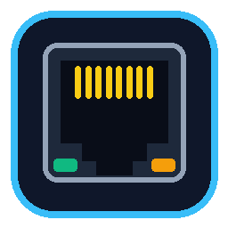

<div align="center">
  
  <h1>FactoryRecon</h1>
  <p><strong>Escáner Ethernet y Descubrimiento de IP para Windows (Sin Drivers Externos)</strong></p>

  
  
  
  
</div>

---

## 📖 Descripción

**FactoryRecon** es una herramienta de escritorio con interfaz gráfica para Windows diseñada para ingenieros de automatización, técnicos de redes y administradores de sistemas que necesitan **conocer la dirección IP, dirección MAC, fabricante y puertos abiertos de un equipo conectado directamente por cable Ethernet (RJ45)** a su PC.

A diferencia de otras herramientas que obligan a instalar drivers de captura en el kernel como *Npcap* o *WinPcap*, **FactoryRecon funciona 100% con APIs nativas de Windows** (`iphlpapi.dll`, sockets UDP Broadcast/Multicast y enrutamiento On-Link de Capa 2), permitiendo detectar equipos incluso cuando se encuentran configurados con una **IP fija en otra subred distinta** a la de la computadora.

---

## ✨ Características Principales

- 🔌 **Cero Drivers Externos:** Usa directamente `SendARP` y `GetIpNetTable` de `iphlpapi.dll` junto con sockets nativos de Windows (`WinSock2`).
- 🌐 **Detección en Subredes Distintas (Cross-Subnet Discovery):**
  - **Escucha Pasiva y Sondas Broadcast/Multicast:** Detecta tráfico `mDNS` (5353), `SSDP/UPnP` (1900), `WS-Discovery/ONVIF` (3702), `NetBIOS` (137/138) y `EtherNet/IP ListIdentity` (44818) proviniendo de equipos en cualquier segmento IP sin cambiar la IP de tu PC.
  - **Barrido Capa 2 Multi-Subred (Modo Administrador):** Sondea automáticamente rangos estáticos comunes (`192.168.0.x`, `192.168.1.x`, `192.168.2.x`, `192.168.10.x`, `192.168.100.x`, `192.168.250.x`, `10.0.0.x`, `172.16.0.x`) mediante rutas *On-Link* temporales sin interrumpir tu conexión.
- 🏭 **Base de Datos OUI Industrial y TI Integrada:** Identifica al instante por dirección MAC equipos **Siemens SIMATIC, Allen-Bradley (Rockwell), Schneider Electric, Omron, Beckhoff, WAGO, Phoenix Contact, Moxa, Hikvision, Dahua, Axis, Ubiquiti, MikroTik, Cisco, Raspberry Pi**, entre otros.
- ⚡ **Escáner de Puertos Industriales y de Red:** Detecta puertos abiertos como HTTP/HTTPS (`80`/`443`/`8080`), Siemens S7 (`102`), Modbus TCP (`502`), EtherNet/IP (`44818`/`2222`), OPC UA (`4840`), Omron FINS (`9600`), Profinet (`34964`), BACnet (`47808`), RTSP (`554`), SSH (`22`) y RDP (`3389`).
- 🔗 **Botón "Igualar Subred PC":** Agrega con un solo clic una IP secundaria compatible en tu adaptador Ethernet de Windows para que puedas abrir la interfaz web del equipo o conectarte con tu software de programación de inmediato.

---

## 🚀 Instalación y Uso

### 1. Clonar el repositorio

```bash
git clone https://github.com/0xK4l3/FactoryRecon.git
cd FactoryRecon
```

### 2. Instalar dependencias

```bash
pip install -r requirements.txt
```

### 3. Ejecutar la aplicación

Puedes iniciarla directamente con Python:

```bash
python app.py
```

O utilizando los lanzadores incluidos para Windows:
- **`Iniciar_FactoryRecon.bat`**: Abre la interfaz gráfica en modo estándar.
- **`Iniciar_Como_Admin.bat`**: Abre la aplicación con permisos de Administrador (recomendado para habilitar el barrido ARP directo en otras subredes y el botón *"Igualar Subred PC"*).

---

## 📦 Compilar Ejecutable Independiente (`.exe`)

Si deseas generar un único archivo ejecutable portable `FactoryRecon.exe` que no requiera tener Python instalado en otras PCs:

```bash
pip install pyinstaller
pyinstaller --noconfirm --onefile --windowed --icon=rj45_icon.ico --add-data "rj45_logo.png;." --add-data "rj45_icon.ico;." --name FactoryRecon app.py
```

El ejecutable final se encontrará en la carpeta `dist/FactoryRecon.exe`.

---

## 🗂️ Estructura del Proyecto

```text
FactoryRecon/
├── app.py                     # Interfaz gráfica principal (CustomTkinter)
├── scanner_engine.py          # Motor de escaneo ARP nativo, sondas UDP y rutas Capa 2
├── oui_db.py                  # Base de datos OUI de fabricantes (Industrial + IT)
├── icon_gen.py                # Generador del ícono y logo vectorial RJ45
├── rj45_logo.png              # Logo RJ45 en alta resolución
├── rj45_icon.ico              # Ícono multi-resolución para ventana de Windows
├── Iniciar_FactoryRecon.bat   # Lanzador rápido de escritorio
├── Iniciar_Como_Admin.bat     # Lanzador con elevación UAC (Modo Administrador)
├── requirements.txt           # Dependencias de Python
└── LICENSE                    # Licencia MIT
```

---

## 📄 Licencia

Distribuido bajo la licencia **MIT**. Consulta el archivo [LICENSE](LICENSE) para más detalles.

